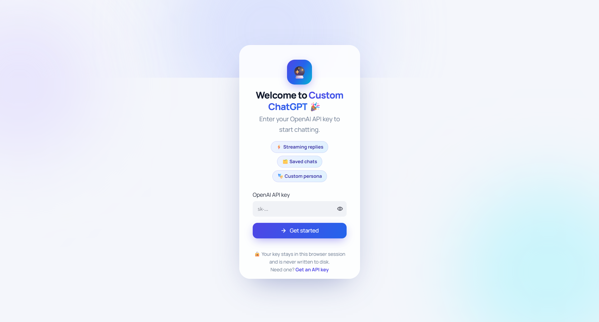

# Custom ChatGPT

A chat interface for the OpenAI API, built with Streamlit and LangChain. I built it to have a clean, local ChatGPT-style app where I control the model, the system prompt, and where my chat history is stored.



## Features

- Streaming responses
- Chat history saved locally and searchable from the sidebar
- Chats grouped by date (Today, Yesterday, Previous 7 days, Older)
- Choice of model: `gpt-5.2`, `gpt-4.1`, `gpt-4o`, `gpt-4o-mini`
- Adjustable temperature
- Editable system prompt, so you can change how the assistant behaves
- API key is checked on entry and kept only for the current session

## Requirements

- Python 3.9 or newer
- An OpenAI API key ([get one here](https://platform.openai.com/api-keys))

## Installation

```bash
git clone https://github.com/<your-username>/<repo-name>.git
cd <repo-name>
pip install -r requirements.txt
```

## Usage

```bash
streamlit run chatgpt.py
```

Enter your API key on the first screen and start chatting. Model, temperature, and system prompt can be changed under **Settings** in the sidebar.

## How it works

Messages are sent to OpenAI through LangChain's `ChatOpenAI` and streamed back into the Streamlit UI. The system prompt is sent as the first message of every request, followed by the full conversation so the model has context.

Conversations are stored in `chat_history.json` in the project folder. Your API key is held in Streamlit's session state and is never written to disk.

## Project structure

```
.
├── chatgpt.py          # the app
├── requirements.txt
└── chat_history.json   # created automatically on first message
```

## Notes

- `chat_history.json` contains your conversations in plain text. It's listed in `.gitignore`, so don't commit it.
- API usage is billed by OpenAI according to the model you choose.
- The app has no authentication, so it's meant for personal or local use.

## License

MIT
